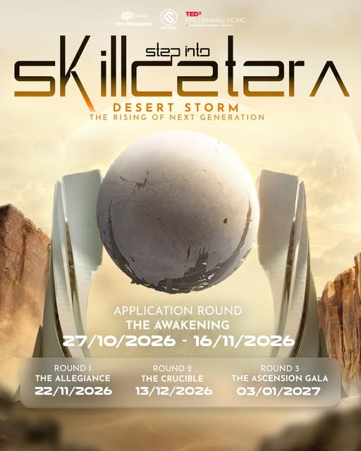
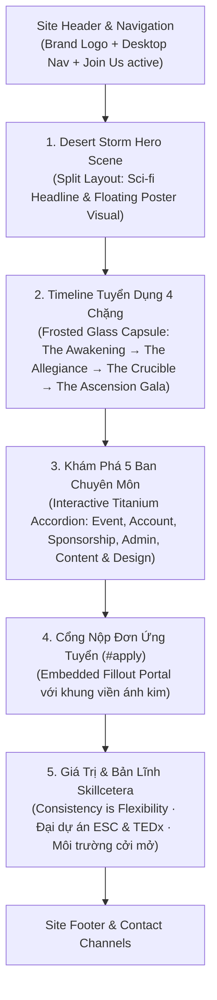

# Thiết Kế Trang Join: Step Into Skillcetera — Desert Storm
## *The Rising of Next Generation · Recruitment Campaign 2026*

---

## 1. Tổng Quan & Cảm Hứng Thị Giác

Trang tuyển quân `/join` được tái thiết kế toàn diện theo chủ đề **Desert Storm — The Rising of Next Generation** từ ấn phẩm poster chính thức của Skillcetera mùa tuyển sinh 2026.



### Bản Sắc Nghệ Thuật (Art Direction)
* **Chủ đề trung tâm:** Đấu trường sa mạc viễn tưởng (Sci-fi Desert Odyssey) kết hợp quả cầu Relic cổ xưa lơ lửng giữa hai đài quan sát hiện đại dưới ánh dương rực rỡ.
* **Tinh thần thông điệp:** Khơi dậy tiềm năng lãnh đạo, vượt qua thử thách khắc nghiệt của bão cát (*Desert Storm*) để vươn lên thành thế hệ kế thừa ưu tú của Skillcetera.
* **Chất liệu thị giác:** Kính mờ phủ sương sa mạc (Frosted Desert Glass), đường viền ánh kim mỏng (Golden Hairline Accents), vầng hào quang ấm (Ambient Sunburst Aura), và khối đá Canyon nguyên khối.

---

## 2. Bảng Màu & Hệ Thống Design Tokens

```css
:root {
  /* Desert Storm Palette */
  --desert-gold: #e5b05c;
  --desert-gold-hover: #f3c477;
  --desert-gold-dim: rgba(229, 176, 92, 0.22);
  --desert-gold-glow: rgba(229, 176, 92, 0.45);
  
  --canyon-base: #0b0a09;
  --canyon-card: rgba(22, 19, 16, 0.85);
  --canyon-surface: rgba(35, 30, 24, 0.65);
  --canyon-border: rgba(229, 176, 92, 0.2);
  --canyon-border-active: rgba(229, 176, 92, 0.6);
  
  --sand-text-high: #fbf7ee;
  --sand-text-muted: #c4b8a5;
  --sand-text-dim: #8a7e6f;
  
  --desert-glass: rgba(18, 15, 12, 0.78);
  --desert-shadow: 0 24px 60px rgba(0, 0, 0, 0.6), 0 0 40px rgba(229, 176, 92, 0.12);
}
```

---

## 3. Kiến Trúc Nội Dung & Bố Cục Trang `/join`



---

## 4. Chi Tiết Từng Phân Khu (Section Specifications)

### 4.1. Phân khu Hero: "The Rising of Next Generation"
* **Bố cục 2 cột (Desktop Grid 1.15fr : 0.85fr):**
  * **Cột trái (Content):**
    * Tag định danh: `STEP INTO SKILLCETERA · RECRUITMENT 2026`
    * Tiêu đề chính dạng Split Sci-fi Typography:
      ```html
      <h1 class="join-hero-title">
        DESERT STORM<br>
        <em>The Rising of Next Generation</em>
      </h1>
      ```
    * Đoạn dẫn (Lead):
      > *"Trực tiếp đứng sau sân khấu của hai đại dự án thường niên ESC và TEDxFPTUniversityHCMC. Đánh thức tiềm năng cá nhân, làm chủ kỹ năng tổ chức chuyên nghiệp và cùng bứt phá trong mùa tuyển quân 2026."*
    * Nút hành động chính (Dual CTAs):
      * Nút vàng ánh kim: `Nộp đơn ứng tuyển (The Awakening) ↓` *(cuộn mượt tới `#apply`)*
      * Nút viền kính: `Khám phá 5 ban chuyên môn ↓` *(cuộn tới `#depts`)*
  * **Cột phải (Visual Showcase):**
    * Tấm poster chiến dịch `public/assets/sisc-desert-storm.jpg` đặt trong khung kính viễn tưởng vát góc nhẹ, tỏa hào quang vàng ấm, có hiệu ứng hover nghiêng nhẹ (subtle 3D depth).

---

### 4.2. Lộ Trình Tuyển Quân 4 Chặng (Recruitment Roadmap Capsule)
Tái hiện trung thực bảng tiến trình ở chân poster thành một **thanh điều hướng tương tác** gồm 4 chặng:

| Chặng | Tên giai đoạn | Thời gian | Trạng thái | Ý nghĩa |
|---|---|---|---|---|
| **00** | **THE AWAKENING** | `27/10 – 16/11/2026` | 🟢 **ĐANG MỞ ĐƠN** | Vòng nhận đơn ứng tuyển qua cổng Fillout trực tuyến |
| **01** | **THE ALLEGIANCE** | `22/11/2026` | ⏳ Sắp diễn ra | Chặng đánh giá năng lực ban đầu & thử thách tinh thần đồng đội |
| **02** | **THE CRUCIBLE** | `13/12/2026` | ⏳ Sắp diễn ra | Phỏng vấn chuyên sâu & giải quyết đề bài thực tế từ các Trưởng ban |
| **03** | **THE ASCENSION GALA** | `03/01/2027` | ⏳ Sắp diễn ra | Đêm hội chào đón và chính thức công nhận thế hệ thành viên mới |

> [!IMPORTANT]
> Chặng **The Awakening** đang trong thời gian diễn ra (`27/10 – 16/11/2026`), có badge hiệu ứng nhịp đập vàng hổ phách (pulsing golden dot) để thu hút ứng viên nộp đơn ngay.

---

### 4.3. Bảng 5 Ban Chuyên Môn (Departments Exploration)
Giữ trọn vẹn mô tả công việc (JD) chuẩn hóa của Skillcetera, trình bày trên nền thẻ card kính mờ sang trọng:

1. **01 · Event Department (Sản xuất & Vận hành Onsite):**
   * *Nhiệm vụ:* Quản lý trang thiết bị, lập checklist onsite, điều phối sân khấu trực tiếp tại ESC & TEDx.
   * *Kỹ năng:* Logistics, Checklist Management, Vendor Coordination, Onsite Operations.
2. **02 · Account Department (Quản trị Đối tác & Nhà trường):**
   * *Nhiệm vụ:* Làm việc trực tiếp với phòng PDP, kiểm duyệt hồ sơ văn bản, hợp đồng và chăm sóc Diễn giả.
   * *Kỹ năng:* Stakeholder Management, Official Documentation, Negotiation, Presentation.
3. **03 · Sponsorship Department (Tài trợ & Phát triển Đối tác):**
   * *Nhiệm vụ:* Xây dựng Sponsorship Proposal, đàm phán quyền lợi và duy trì nguồn lực tài chính với doanh nghiệp.
   * *Kỹ năng:* Fundraising Pitching, Contract Negotiation, CRM, Partner Deliverables.
4. **04 · Admin Department (Văn hóa & Đào tạo Nội bộ):**
   * *Nhiệm vụ:* Theo dõi KPI, tổ chức Team-building/Training, xây dựng lưu trữ tài liệu câu lạc bộ.
   * *Kỹ năng:* People Operations, Performance Tracking, Internal Culture, Process Design.
5. **05 · Content & Creative Design (Sáng tạo Nội dung, Thiết kế & Media):**
   * *Nhiệm vụ:* Xây dựng nhận diện thương hiệu, viết bài truyền thông, sản xuất ảnh và video nghệ thuật.
   * *Kỹ năng:* Brand Identity, Copywriting, Visual Arts, Video Post-production.

---

### 4.4. Cổng Đăng Ký Trực Tiếp (`#apply`)
* Tiêu đề: **Apply for Desert Storm — Round 0: The Awakening**
* Phụ đề: *Hạn nộp hồ sơ kết thúc vào 23:59 ngày 16/11/2026. Hãy hoàn thành biểu mẫu bên dưới để bắt đầu hành trình.*
* Khung nhúng:
  * Lồng `iframe` Fillout Form (`https://skillcetera.fillout.com/t/s3dAm5Lr6rus?embed=1`) trong container kính mờ viền vàng rực rỡ, chiều cao tối ưu không bị giật lag khi cuộn.
  * Nút dự phòng: Mở trực tiếp biểu mẫu Fillout trong tab mới nếu trình duyệt chặn iframe.

---

## 5. Kế Hoạch Triển Khai Kỹ Thuật (Implementation Steps)

1. **Asset Management:**
   * Sử dụng file ảnh đã lưu tại [`public/assets/sisc-desert-storm.jpg`](./public/assets/sisc-desert-storm.jpg).
2. **Cấu trúc HTML (`pages/join.html`):**
   * Thay thế nội dung Hero và thanh Status bằng khối **Desert Storm Hero** và **Recruitment Roadmap 4 Chặng**.
   * Cập nhật các nhãn phân ban, bổ sung ID neo `#depts` và `#apply`.
3. **Hệ thống CSS (`src/join.css`):**
   * Bổ sung bộ biến màu Desert Storm vào đầu tệp.
   * Thiết kế style cho Roadmap Capsule Bar (desktop dạng hàng ngang 4 cột, mobile dạng thẻ dọc thanh lịch).
   * Tối ưu hiệu ứng hover ánh kim và chuyển động đóng/mở accordion.
4. **Build & Verify:**
   * Chạy `npm run check` và `npm run build` để đồng bộ ra `dist/join.html` và `dist/pages/join.html`.
   * Kiểm tra giao diện hiển thị trên server dev cục bộ trước khi push.
